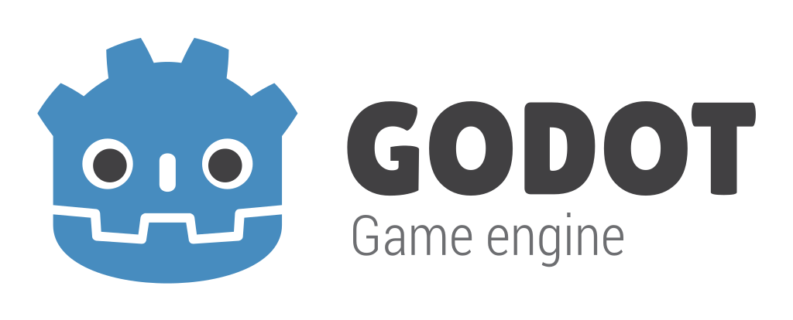

# Godot Engine

<p align="center">
  <a href="https://godotengine.org">
    
  </a>
</p>

## 2D and 3D cross-platform game engine

**[Godot Engine](https://godotengine.org) is a feature-packed, cross-platform
game engine to create 2D and 3D games from a unified interface.** It provides a
comprehensive set of [common tools](https://godotengine.org/features), so that
users can focus on making games without having to reinvent the wheel. Games can
be exported with one click to a number of platforms, including the major desktop
platforms (Linux, macOS, Windows), mobile platforms (Android, iOS), as well as
Web-based platforms and [consoles](https://godotengine.org/consoles).

## Free, open source and community-driven

Godot is completely free and open source under the very permissive [MIT license](https://godotengine.org/license).
No strings attached, no royalties, nothing. The users' games are theirs, down
to the last line of engine code. Godot's development is fully independent and
community-driven, empowering users to help shape their engine to match their
expectations. It is supported by the [Godot Foundation](https://godot.foundation/)
not-for-profit.

Before being open sourced in [February 2014](https://github.com/godotengine/godot/commit/0b806ee0fc9097fa7bda7ac0109191c9c5e0a1ac),
Godot had been developed by [Juan Linietsky](https://github.com/reduz) and
[Ariel Manzur](https://github.com/punto-) for several years as an in-house
engine, used to publish several work-for-hire titles.


## Getting the engine

### Binary downloads

Official binaries for the Godot editor and the export templates can be found
[on the Godot website](https://godotengine.org/download).

### Compiling from source

[See the official docs](https://docs.godotengine.org/en/latest/engine_details/development/compiling)
for compilation instructions for every supported platform.

## Community and contributing

Godot is not only an engine but an ever-growing community of users and engine
developers. The main community channels are listed [on the homepage](https://godotengine.org/community).

The best way to get in touch with the core engine developers is to join the
[Godot Contributors Chat](https://chat.godotengine.org).

To get started contributing to the project, see the [contributing guide](CONTRIBUTING.md).
This document also includes guidelines for reporting bugs.

## Documentation and demos

The official documentation is hosted on [Read the Docs](https://docs.godotengine.org).
It is maintained by the Godot community in its own [GitHub repository](https://github.com/godotengine/godot-docs).

The [class reference](https://docs.godotengine.org/en/latest/classes/)
is also accessible from the Godot editor.

We also maintain official demos in their own [GitHub repository](https://github.com/godotengine/godot-demo-projects)
as well as the [Asset Store](https://store.godotengine.org/).

There are also a number of other
[learning resources](https://docs.godotengine.org/en/latest/community/tutorials.html)
provided by the community, such as text and video tutorials, demos, etc.
Consult the [community channels](https://godotengine.org/community)
for more information.

[](https://www.codetriage.com/godotengine/godot)
[](https://hosted.weblate.org/engage/godot-engine/?utm_source=widget)

---

# Olympus 工作区

本仓库是奥林匹斯（Olympus）的工作区。框架以共工为上游，保留奥林匹斯名称体系；独立的赫尔墨斯文件数据模块豁免同步覆盖。

| 路径 | 用途 |
| --- | --- |
| `Olympus/` | 框架、Agent、skill、契约与同步工具 |
| `olympus-hermes-data/` | 需求生产数据，独立命名，必须随需求产出合入 Git |
| `olympus-workspace.json` | 工作区约定与入口 |
| `work-items.json` / `.github/ISSUE_TEMPLATE/` | GitHub Issue 工单约定及按任务类别预设标签的表单 |
| `design-docs/` | Markdown 需求与设计文档，引用实际 Issue |
| `data-collection/` | 谛听采集交接目录，保留真实事件来源与摘要 |
| `tools/verify_workspace.py` | 全量同步检查与文件数据 Git 检查 |
| `Olympus/modules/ariadne/` | 已同步共工登记的司南 0.2.1 模块，Olympus 名称为阿里阿德涅 |

2026-11-02 出包：保留共工 v0.9.0 主线，合并另一来源树中已正式登记的司南 0.2.1；当前 3 个 Agent、10 个 skill。模块登记、实现证据与来源均保留，15 项隔离测试通过。模块已进入 Olympus 清单；改名副本准入仍待审，未部署真实工单服务，不新增同步豁免。

Python 3.10+、Node.js、Git 可用于本地验证；赫尔墨斯文件模式无需数据库。仓库初始化数据后，新需求按 `Olympus/extensions/hermes-files/README.md` 生成真实事件。禁止将生产数据放入会随上游重建的 `Olympus/` 目录。

## 验证与数据分析

将 `GONGGONG_FRAMEWORK_SOURCE` 指向实际共工 `CURRENT_FRAMEWORK.json` 或有效框架根。仓库不提交机器本地源路径。上游缺失或不一致时，框架验证及 Agent 上下文装配会阻断；独立文件数据分析仍可执行。

```powershell
$env:GONGGONG_FRAMEWORK_SOURCE = 'PATH/TO/CURRENT_FRAMEWORK.json'
$env:GONGGONG_SINAN_FRAMEWORK_SOURCE = 'PATH/TO/FRAMEWORK-WITH-REGISTERED-SINAN'
$env:GONGGONG_SINAN_IMPLEMENTATION_SOURCE = 'PATH/TO/GONGGONG-WORKORDERS'
python tools/verify_workspace.py --require-committed
python Olympus/extensions/hermes-files/hermes_files.py analyze --repo . --tenant olympus-workspace
```

文件数据记录须使用实际 Agent 快照、来源和时间。导入模板前填写真实字段；未知用量保持 null，不能伪造成 0。工具会保留历史版本，校验事件摘要及引用；Git 检查区分已记录、已跟踪、已提交，不能以本地提交冒充远程合并。

## 共工同步

从本仓库当前的 `Olympus/sync/gonggong_sync.py` 发起同步，生成新的临时框架目录，完成全量验证后按 Git 变更流程替换 `Olympus/`。不可用共工原件直接覆盖奥林匹斯目录。同步会逐字节携带现有 `extensions/hermes-files/`，遇到上游占用豁免路径时拒绝继续；不得覆盖或删除仓库根 `olympus-hermes-data/`。

完整规则见 `Olympus/sync/POLICY.md`。本仓库没有常驻同步服务；框架注册仍保持待独立准入状态，本次仓库接入不伪造 Agent 批准或宿主运行授权。
