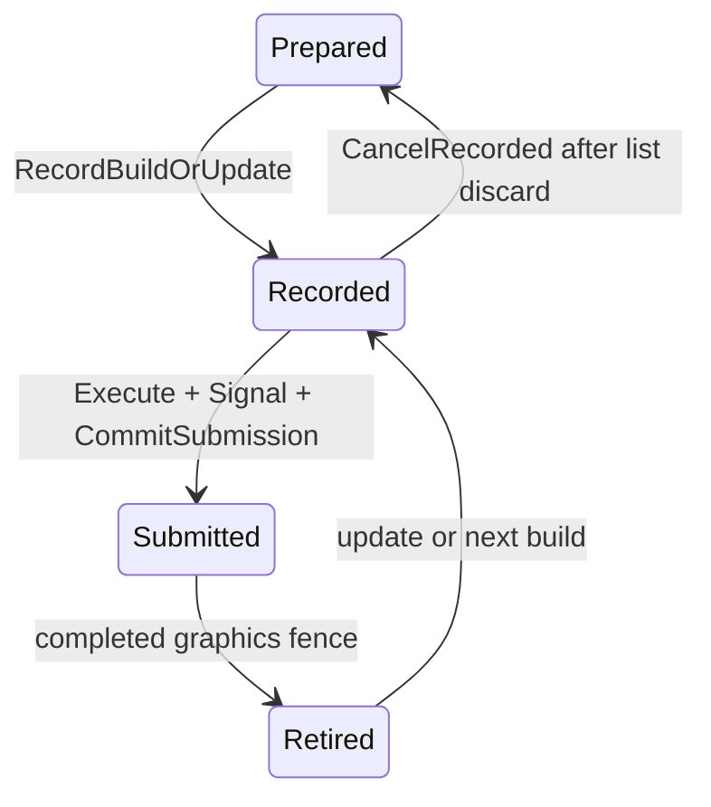

# Engine Next 光追场景后端

本分片关联 Issue #1343，提供 Windows 私有 D3D12 BLAS/TLAS 管理和可复现的 Inline RayQuery 验证入口。GI 的辐射度积分、探针采样和运行器接线由后续调用者完成。

## 位置与复用

`RhiComOwner.h` 和 `RayTracingScene.h/.cpp` 位于 `engine_next/Platform/Windows/`。该路径属于现有 next_visual_client 的 D3D12 私有后端准入范围。公共 `engine_next/include` 继续只包含跨平台接口。`ComOwner` 模板从现有 VisualRuntime 精确提取，保留接口和引用释放行为，运行器后续可以直接包含它。

场景输入复用 `RenderScene`、`MeshPrimitive`、`MeshVertex` 和 `MaterialData`。顶点保持 48 字节，UV 偏移为 40，索引为 uint32。按 asset/primitive 去重构建静态 BLAS，每个 RenderInstance 创建一个 TLAS 实例。InstanceID 是稳定的当前快照索引，其对应记录同时保存 entity、asset、primitive、node 和 geometry。

MaterialData 完整复制到 SourceMaterials，保留纹理、透明和其他源材质字段。上传的轻量材质记录保存 base color、emissive、roughness、metallic、normal scale、occlusion strength、alpha mode、cutoff 和纹理/采样器索引。TextureBindings 保留 asset/local texture 定位及原 TextureData，调用者据此复用原采样器与贴图。

## 所有权与生命周期

所有可变操作限定同一 owner thread，使用同一 DIRECT graphics queue 的 fence 域。传入 device 和 command list 仅在调用期间借用。后端持有 GPU buffer 的 COM 引用，调用者持有纹理、descriptor heap 和 queue。纹理与 descriptor 在最后使用它们的 graphics fence 完成前保持有效。

Prepare 先验证全部参数、拓扑、材质和变换，查询 prebuild size 与实际 allocation size，再创建独立候选。资源限额或创建失败保留原场景。替换已有场景前要求其全部使用 fence 已完成。

每个 frame slot 拥有独立 TLAS、TLAS scratch 和 instance upload。首次使用某个 slot 总是完整 build，该 slot 提交成功后后续才使用 PERFORM_UPDATE。原位 update 之前要求该 slot 最后使用 fence 已完成。

首个录制同时包含几何上传和静态 BLAS build，BLAS build 之间为共享 scratch 插入 UAV barrier。TLAS build/update 后插入 UAV barrier，因此同一 command list 可以随后消费其地址。跨 queue 的消费必须由调用方设置显式 fence wait。

CancelRecorded 要求调用者先丢弃或重置未提交 command list，后端撤销 pending 标志。CommitSubmission 只在 ExecuteCommandLists 和 Signal 成功后调用，登记 frame fence 并更新已提交状态。MarkUsed 为复用已构建 TLAS 的后续命令登记 fence。Retire 在静态 build fence 完成后释放初始 geometry upload 和 BLAS scratch。Release 拒绝仍有 pending 录制或未完成使用的对象。

宿主在析构、移动覆盖或销毁后端前执行最后一次 queue wait 与 Release。该后端沿用现有运行器显式 flush 的责任分配。

## 预算与布局

默认 resident、scratch、upload 限额分别为 512 MiB、256 MiB、256 MiB，可由调用者提供。resident 包含合并的 VB/IB、BLAS result pool 和三组 TLAS。scratch 包含首建 BLAS 的共享 scratch 及三组 TLAS scratch。upload 包含初始 geometry staging、只读 draw/material 映射和三组实例数据。

每项限额依据 GetResourceAllocationInfo 的真实 allocation size 计算，payload 与 allocation 分别报告。BLAS result 在合并池中按 256 字节对齐，所有大小先通过完整预算检查。PrebuildInfo 阶段对之后会变成有效地址的字段使用对齐非零占位地址，保持空与非空含义一致。

| GPU 记录 | 字节 | 字段 |
| --- | --- | --- |
| MeshVertex | 48 | position、normal、tangent、UV |
| RayTracingDraw | 16 | first index、base vertex、material、index count |
| RayTracingMaterial | 64 | base RGBA、emissive RGBA、surface RGBA、texture、sampler、alpha mode、cutoff |
| D3D12 instance | SDK 固定布局 | row-major 3×4 transform、instance ID/mask、BLAS 地址 |

## Alpha 与空场景

Opaque 使用硬件 opaque 标志。MASK 使用 non-opaque triangle，调用方插值原 UV，按原 base-color alpha 与纹理 alpha 的乘积比较原 cutoff。共享 `RayTracingScene.hlsli` 提供这个判定与 GPU 记录结构。

当前 GI policy 对 BLEND 跳过候选，因此真实透射、折射和透明参与间接光仍需后续实现。DXR 使用 left-handed object-space winding 定义。RH glTF 的 CCW 正面对应默认实例 flag 0，双面材质追加 TRIANGLE_CULL_DISABLE。主查询使用 CULL_BACK_FACING_TRIANGLES。实例变换保留 object-space facing，负 determinant 实例采用同一标志。GPU 回归同时保存顶点叉积、逆变换后的射线点积和 CommittedTriangleFrontFace，分别覆盖 identity、X 反射、Z 反射及双面材质。

空场景仍生成有效空 TLAS。越界的源 primitive、index、material、texture 或非法变换在录制前拒绝。每条非 opaque ray 有显式 candidate 上限，超过上限输出失效状态，便于运行器计数诊断。

## 验证边界

私有 `ray-tracing-scene` harness 直接链接这个后端，通过真实 D3D12 device 构建两个三角形实例并发出 Inline RayQuery。用 2×2 alpha 贴图区分透过与最近命中，另验证新 frame slot 首建、原 slot 更新、空场景、BLEND 跳过、预算失败、index 失败、撤销录制、提前退休和跨线程调用。

最终 r8 在 MSVC 与 clang 构建上分别完成九阶段真实 GPU 查询，64 字节材质、MASK 过滤、实例更新、空场景、BLEND 跳过和四种 facing 情况均通过。两次运行各获得零 validation error 与零 warning。DEFAULT buffer 以 COMMON 创建，首次复制或 scratch 写入前显式转换。结果绑定最终后端源、测试源、exe、shader 和 readback，历史失败尝试继续保留。

加速结构地址、更新约束与同步依据微软 DXR 规范。当前代码为独立实现。[DXR Functional Spec](https://microsoft.github.io/DirectX-Specs/d3d/Raytracing.html)
