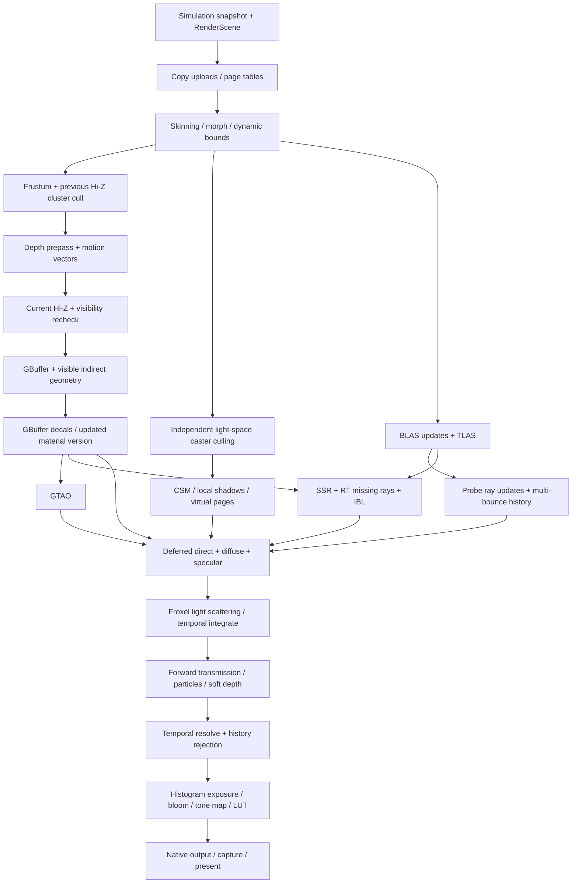

<!-- gonggong-request:engine-next-visual-runtime-m4-20261115 -->

# Engine Next M4 — PC 高画质独立可视运行时

## 当前决定与授权

- 稳定需求 ID 为 `engine-next-visual-runtime-m4-20261115`，类别为 `type:development`，父 Issue 为 [#1323](https://github.com/zhzyx/nightmarish-spooky-sorceryze/issues/1323)。
- 用户于 2026-11-15 提交完整 M4 需求，明确由 Codex 执行，遵循项目 C++ 规范，并允许参考本机 UnrealEngine-5.8.3-release 的渲染管线。
- 用户随后确认以本机 i7-13700KF / RTX 4070 Ti 为参考 PC，先完成设计，并采用自研、可重建的 A–F 基准场景。
- 当前授权覆盖 M4.0 的依赖回读、参考环境和来源核验、文件级设计、基准方案及设计 PR。用户在原需求第六、八节保留了进入实现前的确认。
- 用户于 2026-11-15 明确“请落地”，设计已确认，授权按 M4.1–M4.6 分阶段实现。M4 父单持续开放，后续按阶段形成独立 PR 和验收记录。
- 工作树从 `origin/main@700dfb041cfa8a1dc791e24825ff0ce57a734a52` 创建，分支为 `codex/engine-next-m4-design-20261115`。
- 本文中的渲染架构、预算、材质和场景参数均为 M4.0 待确认设计。已执行证据将单独注明实际来源和结果。

## 目标和本轮交付

新建 `next_visual_client`，复用 M2 模拟、网络和 M3 资产体系，建立独立 Windows 窗口、D3D12 RHI、FrameGraph、GPU Cook、Deferred PBR、GPU 驱动几何、动态 GI、阴影、反射、时域与体积效果。

最终以同资产、同相机、同灯光、同曝光和画质参数的 UE 对照验证视觉。必达性能为原生 3840×2160 High 平均 ≥120 FPS、1% Low ≥90 FPS，连续 30 分钟稳定。挑战为原生 4K 平均 ≥144 FPS、1% Low ≥120 FPS、连续 60 分钟稳定。完整验收遵循下附原始需求。

M4.0 设计通过 PR #1326 合入，用户随后确认实现。M4.1 子 Issue #1327 已建立并完成首轮本机渲染、捕获及回归，当前进入正式交付。各阶段实测和远端回读分别记录。

## 前置依赖回读

| 前置 | 远端依据 | 本轮结论 |
| --- | --- | --- |
| M1 / M1.1 | #939 / #1025，PR #970 / #983 / #1028 / #1039 | 已回读 closed / completed；`0010a548ad5b52ef268e28c5e9c2c6b9a4ae26e2` 和 `78fe4c2bfe9c7e340f20e1318ec8d5edadbfbd02` 均是本轮基线祖先 |
| M2 | #1042，最终回执 PR #1237 | 已回读 closed / completed；`6ef7879a8e606a50ecbd3b720dabbdb6eee5d583` 是本轮基线祖先 |
| M3 | #1240，最终 PR #1302 | 已回读 closed / completed；`0bc22d445086e8f9cdacd43dfe3817c7690bcf41` 是本轮基线祖先 |

M3 最终签发 head 为 `6b5daa0f15de7bc30a1ba5ec64795a3cc1b11676`。三平台 no-Godot、静态、工单和所需编辑器检查已成功，条件跳过项保留各自状态。M3 仓库设计首页尚描述 PR5 进行中，本轮采用远端最终回执。[M3 最终回执](https://github.com/zhzyx/nightmarish-spooky-sorceryze/issues/1240#issuecomment-6888020670)、[最终 PR](https://github.com/zhzyx/nightmarish-spooky-sorceryze/pull/1302)

本地证据入口为 `data-collection/engine-next-assets-ai-workflow-m3-pr5-r11-{verification,review,build-impact,legacy-build-impact}.json` 及 `data-collection/engine-next-headless-runtime-m2-final-{platforms,build-impact-r3}.json`。这些记录绑定其原候选；M4 新二进制仍须重新执行受影响回归。

## M4.0 当前实测与待冻结项

| 项目 | 本轮事实 | 冻结条件 |
| --- | --- | --- |
| CPU / RAM | i7-13700KF，16 核 24 线程，约 31.72 GiB RAM | 每次基准附 OS / 电源模式 / CPU 频率和温度记录 |
| GPU | RTX 4070 Ti，nvidia-smi 报告 12282 MiB 显存，驱动 610.60 | D3D12 查询记录 adapter LUID、DXGI 内存预算、feature level、SM、DXR、mesh shader、binding tier |
| OS | Windows 11，build 22631，x86_64 | 记录完整版本和图形调度设置 |
| 显示器 | HKC G27M2Pro，当前 2560×1440 @180 Hz，枚举源模式最大为 2560×1440 | 最终原生 4K 显示输出尚待可用模式及呈现证据；4K 离屏渲染可以先作 GPU 预算实验 |
| VSync / VRR | 本轮尚未实测应用呈现和驱动最终状态 | 性能组 VSync off、确认 tearing support；视觉组独立记录 VRR / HDR / swapchain 色彩空间 |
| UE 本地树 | Build.version 标记 5.8.3，Changelist=0，CompatibleChangelist=55116800；存在编辑器和命令行程序 | 源提交、取得来源和精确配置待核实，启动可用性及自研 A–F 基准待执行 |
| UE 基准 | 尚未生成本任务固定场景截图、动态视频或 GPU Capture | 同一自研资产包、参数与相机轨迹导入后，逐场景采集并冻结摘要 |
| 新引擎基准 | M4.1 已产生独立 D3D12 视觉二进制，具体哈希与验证见子单证据 | M4.1 及后续阶段按精确候选实际采集 |

环境记录见 `data-collection/engine-next-visual-runtime-m4-environment-20261115.json`。当前没有满足完整 M4.0 的 UE 参考采集，当前设计评审与基准冻结分别记录。用户已于 2026-11-15 确认设计并要求落地，M4.1 已开始。A–F 基准素材与 UE 同参采集仍待完成，按父级验收保留。

## 冻结的 M2 / M3 边界

### 资产身份、场景和预算

`Assets::LoadPackage()` 继续验证 `.enpak` 目录的 canonical JSON、完整文件集合、revision、依赖闭包、blob SHA-256 和 Scene 摘要。原始包按 M3 语义读取。

`SceneDocument` v1 只有 transform、父子关系、gameplay 和资产引用，最多 256 个 entity，角色为 `mesh` / `texture`，玩法种类为 `player_spawn` / `static`。摄像机、光源、材质覆写、粒子与渲染配置放入独立的 `RenderConfiguration`，通过原 scene digest、稳定 EntityId 及资产三元组绑定。该配置只描述可视呈现与可重放的基准参数。

单图 16 MiB、单 GLB 64 MiB、单 GLB 100 万顶点 / 200 万三角形、整包 blob 256 MiB 的 M3 限额继续适用。千实例场景由 GLB 中共享 mesh 的多个 node 展开，渲染实例身份为 `(EntityId, glTF node index, primitive index)`。统计同时列源网格三角形、展开场景三角形、可见三角形、实际间接绘制量和驻留页数。

GLB 必须自包含，当前拒绝 URI 与 sparse accessor。M3 结构验证没有完整覆盖材质、动画、skin、morph、纹理采样及 required extensions。GPU Cook 对这些内容独立验证并返回带资产和字段路径的诊断，支持清单与测试一起交付。错误资产阻止该场景基准，原包仍保持可回读。

### 模拟与可视呈现

`RunClient()` 当前是阻塞式验收入口，内部保存网络、预测、插值与重连状态。M4.2 提取可逐 tick 驱动的 `ClientSession`，原 `RunClient()` 调用同一实现并保留既有验收行为。

- `ClientSession` 单一模拟线程拥有 ENet、重传队列、`PredictionReconciler`、`InterpolationBuffer` 和重连状态。
- 主线程处理 Win32 消息，输入事件携带单调时间与序号，经有界队列在固定 tick 边界消费。失焦合成按键释放。队列满时记录故障并保留最后输入状态，重连和停止不能被普通鼠标事件挤掉。
- 模拟发布有界三槽 `SimulationSnapshot`，含 EntityId、generation、权威 tick、预测与插值状态。槽位显式区分 free/writing/published/reading，消费者取得 reading 所有权并在用完后确认释放；生产者只能写 free 槽，可替换尚未被读取的旧 published 槽。状态转换使用 acquire/release，同一槽存在 reader 时禁止回绕覆盖。容量不足仅丢旧展示快照，模拟状态和输入不丢弃。
- Render 线程构造独立 `RenderSnapshot`，只在视觉侧应用相机、抖动、动画姿态和展示插值。预测、远端插值、重连仍使用 M2 的时间与协议。
- A–E 使用 `AssetPackage` 的场景数据构建 `RenderScene`。F 同时通过 `SceneRuntime` 验证恰好两个出生点及原始模拟参数。
- 大世界视觉采用相机相对位置与双精度世界变换。M2 binary32 玩法坐标的精度范围继续如实标注，大世界渲染实验与网络玩法范围分别验收。

## 渲染总体设计

### 目标、坐标与颜色

Windows x86_64 首条路径使用自有 D3D12 后端。RHI 公共头采用平台无关值类型、状态和不透明句柄。后续后端按能力接口接入。

- 空间按 glTF 的右手、Y-up、米制解释；模型正面为 +Z，相机局部观察方向为 -Z。四元数使用 `[x,y,z,w]`，矩阵列向量 `M * v`。CPU/HLSL 显式一致的矩阵布局，上传、UE 轴变换和投影各有 golden 测试。
- D3D depth 为 `[0,1]`，Reverse-Z，深度清零、GREATER_EQUAL。Hi-Z 采用与 Reverse-Z 一致的保守约简，包含 near-plane、镜像缩放与相机切换测试。
- 纹理 UV 与图像行原点在 Cook 阶段明确定义并只转换一次。负缩放校正剔除、法线及切线手性。缺失切线时从同一 indexed primitive 生成并记录算法版本。
- 光照计算在线性空间，基色和自发光纹理以 sRGB 解码，法线 / ORM / 深度 / velocity 为线性数据。灯光输入使用方向光 lux、点光 / 聚光 lumen 和面光 cd/m²，Cook 与 UE 导入使用记录的几何面积、角度和换算。
- 中间 HDR 使用 pre-exposure 的线性场景辐亮度。手动曝光基准从 EV100=10、ISO100、f/4、1/64s 开始冻结，并以灰卡校准两端曝光。自动曝光单设测试轨迹，记录历史适应。
- 比较图输出 SDR Rec.709，固定白点与 display transform，保留 tone-map 前 HDR EXR。自有 tone mapper 与 UE 参数曲线分别记录，审查差异归因时使用线性 radiance 对照。

### RHI、线程与 GPU 生命周期

启动枚举 DXGI high-performance adapter，允许显式 LUID 选择。设备实测至少 FL12_0 / SM6.0 支持基础 raster 路径，DXR、mesh shader、enhanced barrier、typed UAV 与 async compute 逐项探测。当前主设计的 GI / RT 反射使用 RayQuery，要求 DXR1.1 与 SM6.5 或更高，通过实测后冻结参考路径。缺失功能给出明确能力诊断并保留未验收项。

主线程持有窗口和输入，Render 线程持有 swapchain、graph 与 GPU 资源；录制工作者只访问当前 frame 的只读场景和各自 command allocator/list。IO 与 Cook worker 通过有界上传请求交接，禁止同步 IO 出现在热渲染路径。

- DIRECT / COMPUTE / COPY 各自 fence，64 位递增值。资源、descriptor、allocator、PSO 的退休条件取其全部使用队列 fence。
- 每帧 2–3 个有界 frame context，呈现默认最大延迟 1。CPU 等待 GPU 的位置和耗时显式记录，资源回收防止帧序号回绕和 resize 后旧资源误用。
- DXGI flip-discard，3 buffer；SDR swapchain `R8G8B8A8_UNORM`、正确 color space，支持 tearing 时按基准配置 present。resize / minimize / restore 等待使用中的 backbuffer，并处理零尺寸与设备移除。
- 上传环形页按 D3D 对齐要求分配，COPY 完成 signal 后消费者 queue wait。读回查询延后多帧读取，无每帧同步阻塞查询。
- DXC 离线编译 HLSL，PSO key 包含 shader、root signature、格式、宏、编译器与驱动环境。运行期预热完整 reference permutation 集合，未知 permutation 的出现单独计入 shader / PSO hitch。
- 开发运行启用 debug layer / GPU validation / DRED before-device；性能运行记录为 validation off。device removed 保存原因、breadcrumbs、page fault、资源命名与最近 graph，不自动以重建设备隐藏失败。

### 显式 FrameGraph

Pass 声明资源版本、读 / 写 / read-write access、子资源范围、queue、输入输出与是否有外部副作用。编译器验证所有生产者、无环依赖、生命周期和格式，然后生成稳定拓扑排序、transition / UAV / alias barrier、queue fence wait/signal。

Transient alias 仅在 GPU happens-before 关系证明两组完整访问不重叠、资源兼容且必要 alias barrier 已建立时使用。跨队列并发 pass 的 CPU 序号不能证明可复用。M4.1 先采用可验证的串行正确路径，异步计算在无依赖窗口实测启用并对比结果。历史资源、swapchain、streaming 页和 acceleration structure 属于 imported / persistent，resize、相机切换与代次变化显式失效。

每帧导出 graph 拓扑、pass / resource ID、队列、格式、尺寸、读写、状态前后值、alias 区间、fence、CPU / GPU 时间、draw / dispatch / indirect 次数。原始数据可缓冲写出，稳态性能测试记录采样率并核实开销。

首帧 / history invalid 的剔除只使用当前保守视锥。上一帧 Hi-Z 拒绝的候选进入当前深度二次验证，避免转向和新显露几何丢失。阴影和 GI 维护自己的可见集，摄像机不可见物体仍能投影或参与间接光。

### RenderTarget 与资源布局

| 资源 | 建议格式与规模 | 内容与生命周期 |
| --- | --- | --- |
| Depth | `R32_TYPELESS` / `D32_FLOAT` + `R32_FLOAT` SRV，4K | Reverse-Z，当前帧；Hi-Z 持久双帧 |
| Velocity | `R16G16_FLOAT`，4K | 当前到上帧 unjittered UV 位移，含 skin/morph；相机抖动单独处理 |
| GBuffer base | `R8G8B8A8_UNORM_SRGB`，4K | 基色与 alpha / coverage |
| GBuffer normal | `R16G16_SNORM`，4K | octahedral world normal |
| GBuffer surface | `R8G8B8A8_UNORM`，4K | roughness、metallic、AO、材质模型 ID |
| GBuffer extended | `R16G16B16A16_FLOAT`，4K | tangent / anisotropy / coat 参数，按完整材质布局明确通道 |
| Emissive / HDR light | `R16G16B16A16_FLOAT`，4K | 线性 pre-exposed emissive 和分离 lighting target |
| Object/material ID | `R32_UINT`，4K | 稳定身份索引，边缘拒绝、拾取与诊断 |
| Shadows | `R32_TYPELESS` / `D32_FLOAT` atlas | CSM / local atlas、虚拟页表、物理页缓存 |
| GI / reflection histories | `R16G16B16A16_FLOAT` + depth/normal moments | world-space probes 与 screen-space specular 分开，记录采样分辨率 |
| TAA histories | `R16G16B16A16_FLOAT` 双缓冲，4K | history、moments、置信度，绑定相机与资源代次 |
| Froxel | `R16G16B16A16_FLOAT`，初始 480×270×64 | 对数深度体积，scatter / transmittance / history |

4K 输出、主可见几何、GBuffer、TAA 与最终合成为 3840×2160，screen percentage 固定 100%。GI / SSR / froxel 的内部采样数量按自定义 High / Ultra 记录并在两引擎间审查等价性，禁止在性能复验时临时降低。MSAA 关闭，使用时域抗锯齿。格式最终由 typed load、显存与误差实验定版。

### Deferred PBR、材质和透明

材质 Schema 位于渲染层，原 AssetRef 及 glTF primitive/material index 为来源。Metallic/Roughness、normal、AO、emissive、alpha modes、双面为基础；扩展覆盖清漆、各向异性、透射、IOR、厚度 / 吸收与 emissive strength。`extensionsRequired` 支持缺失返回明确诊断。

不透明材质使用 GGX、Smith masking、Fresnel、能量补偿与一致的 roughness 映射。IBL 的环境立方体、漫反射 irradiance、GGX prefilter 和 BRDF LUT 由独立 GPU Cook 生成，版本与参数入 key。面光使用独立实现的多边形/重要性采样，记录采样预算及噪声。

HDR 环境源采用 `RenderConfiguration` 中可重建的解析天空和线性光源参数，独立 Cook 生成 FP16 cubemap。UE 对照由同一参数和 Cook HDR 环境导入，转换过程及 hash 留证。M3 输入继续限定 PNG/JPEG/自包含 GLB，HDR/EXR 只作为渲染层派生产物与采集输出；普通 PNG/JPEG 的解码结果按其真实动态范围处理。

Shader permutation 仅覆盖实际模型、alpha、skin/morph、shadow 与 debug 的有界组合；材质数值进入 buffer，避免以每个数值创建 PSO。Decal 在 GBuffer 之后读取深度与原材质，输出更新后的 GBuffer resource version，保留原材质身份。AO、SSR 和 Lighting 统一读取该版本，避免贴花后的法线与粗糙度不同步；读写使用分离目标以满足 D3D12 的资源状态约束。

透射与半透明在独立 forward pass 处理，读 opaque HDR / depth 与反射 / 环境。一般透明使用稳定排序，交叠复杂场景使用 per-pixel 有界 fragment list 并检测溢出；粒子可采用有记录误差的 weighted blended 分支。分支质量分别验收，出现排序/overflow 缺陷即记录失败。折射显式限制次数并记录离屏 fallback。双面薄片法线、厚度、遮挡与阴影传输分别有测试。

### GPU 驱动几何、LOD 与 streaming

Cook 把 indexed triangle mesh 分解为有限 cluster（起始上限 64 vertices / 126 triangles），生成邻接、保守 bounds / normal cone、几何误差和多层简化 hierarchy。保留 UV / 硬边 / 材质边界，并生成压缩页、依赖、parent fallback 与解码校验。Skin/morph 的动态 bounds 不应用未经验证的静态 normal-cone 剔除。

Compute 对 instance / hierarchy 做视锥、屏幕误差和 Hi-Z 测试，生成可见 cluster 与 `ExecuteIndirect` 参数。首条路径使用 indexed indirect draws 与分组 PSO；mesh shader 是经探测后的加速分支。CPU 按有限 pass / material batch 提交，实例数量不产生同阶 CPU draw 调用。

LOD 请求依据屏幕误差与 residency，迟滞稳定选择。root/coarse 页始终驻留，细页在 IO/COPY fence 完成后原子更新页表；淘汰等待所有 queue fence。缺页使用保守 parent，统计 fallback 与画面变化，持续质量不足计入基准失败。纹理按投影 texel 密度与反馈 stream mip，预取使用固定相机速度上界，预算不足返回真实缺页/驻留指标。

### 动态 GI、阴影和反射路线

参考 GPU 主路线选择 DXR1.1 ray query 的多级 world-space irradiance probes / clipmap，加可见面 specular rays。动态 BLAS refit / rebuild 和 TLAS 更新进入 graph，所有会影响阴影/GI 的相关离屏实例参与 acceleration structure。

- Diffuse probes 记录 radiance、可见性距离 moments、有效性、更新时间与场景代次。relocation / classification 处理墙内 probes，跨墙插值使用可见性约束。
- 每帧有界更新优先动态 light / geometry / emissive dirty 区域。probe ray 的 hit lighting 包含直接项及前次 probe 间接项，以实际迭代收敛多次反弹，记录能量、延迟、噪声与收敛曲线。
- 自发光面积采样和 emissive hit 纳入传输，防止只看到发光表面而未照亮邻面。denoiser 使用 motion、depth、normal、roughness、稳定 ID、variance 及 history confidence；变化区增加更新而不保留失效历史。
- SSR 做 roughness-aware hierarchical tracing。缺失 / offscreen ray 使用 DXR，远距离或低置信度终止后使用记录的 probes / IBL。清漆分层 BRDF 与透射材质分别计算并合成，检查暗边与能量。
- 阴影先实现 stabilized CSM、点光 cube / spot atlas、PCF/PCSS，M4.4 增加虚拟页表与按可见需求分配的高细节 shadow cache。camera/light/instance/material 变化使相关页失效；页溢出、bias 与过滤半径进入诊断。

GI 内部低采样是固定质量档参数。最终判定包含多反弹、自发光、动态几何、屏幕外响应与运动稳定性。性能目标不足时继续优化并保留失败数据。

### 时域、体积与动态几何

相机采用固定序列 jitter，记录每帧索引。Velocity 包含 camera、对象刚体、skin 与 morph 的当前/上帧矩阵。camera cut、resize、重连代次、材质/LOD 突变明确拒绝历史。TAA 使用重投影、邻域 clip、variance / reactive mask、深度法线拒绝与置信度；调试输出历史权重和 rejection cause。

后处理依次处理 temporal resolve、metering / exposure、bloom、sharpen、tone map、color LUT 与 vignette。UI/debug overlay 在最终显示空间合成，采集无 overlay 的基准图与另行保存的诊断图。

Froxel 采用 log-depth slices，显式 extinction、scattering albedo、Henyey–Greenstein g，注入方向与局部阴影光，积分 transmittance。历史重投影采用相机 / light / volume 变化置信度，记录空域去噪。粒子按固定随机种子和 simulation time 演进，保存 motion、soft-depth、透明层排序和边界诊断。

Skin 与 morph 的解码、权重归一化、骨架层次 / inverse bind、动画 channel interpolation 在 GPU Cook 严格验证。时间驱动使用 snapshot 时间，上一姿态持续到对应 frame retirement，切 clip/teleport 使 velocity history 失效。E 场景必含运动角色、刚体、灯光和材质。

## GPU Cook 与独立发布

`next_asset` 的原 pack / inspect / validate 入口继续可用；新增显式 `gpu-cook` 子命令，只读原 `.enpak`，生成独立 `.engpu` 目录。原包 LoadPackage 的全量 CPU 读取属于启动验证，流送只消费新 GPU 页。

GPU Cook key 包含原 package/scene digest、每个 AssetRef 三元组、Cook版本、目标后端/format、shader compiler/version、material schema、编码参数与依赖摘要。GPU manifest canonical 排序，去除时间戳与机器路径。同输入同配置双目录 byte-identical 验证。缓存命中必须先检查完整 key 与页 hash，取消/失败不能发布半包。

Mesh 页包含 vertices / indices / cluster hierarchy、skin/morph、primitive/material 映射。纹理解码后生成正确过滤的完整 mip，base/emissive 用 sRGB 边界、normal mip 重新归一化。优先 BC7 base、BC5 normal、BC1 opaque / BC3 alpha 兼容档，记录 encoder 版本、通道、alpha coverage 与误差；无损中间结果用于查错。

页表验证偏移、长度、对齐、预算、重复 ID、摘要与闭包。发布采用 staging + atomic no-clobber。启动核对 GPU 包的 source key 与原包，损坏或错版拒绝并给诊断，允许用户显式重新 Cook。

新增独立 `BuildVisualRuntime.py` / `PackageVisualRuntime.py`，复用 M2 实际 response / hash / symbol / dependency 检查。视觉目标按受审 target profile 扩充 `d3d12`、`dxgi`、`dxguid`、`user32` 和必要 SDK includes；DXC 离线工具依赖单独登记，避免把无关库加入 headless profile。

发布包包括 next_visual_client、授权运行库、固定 shaders / PSO 配置、`.engpu` 与源 `.enpak` 的引用清单、许可证及哈希。标准测试在干净目录验证原生 DLL 依赖和实际执行，Windows RHI 头不进入公共 M2/M3 头。显示资源能力与 CLI 错误状态均结构化输出。

## 文件级实现计划与 C++ 约束

下面路径是设计中的计划文件，当前 PR 只交付文档和证据。对外接口使用 C++17，函数/类型/文件 PascalCase、类型前缀变量、Allman、制表符、直接 include、明确单位和错误传播。异常处理不进入源码。独立内核延续已验收 M1 的标准 C++ 容器/RAII 和 M2/M3 所有权设施，参考依据为 `design-docs/engine-next-gameplay-core-m1-20261112.md` 的独立核心约定。

| 计划路径（相对仓库） | 职责 / 所有者 | 阶段 |
| --- | --- | --- |
| `engine_next/include/EngineNext/Rendering/{Types,Capabilities,RenderConfiguration,RenderSnapshot}.h` | 格式、尺寸、状态、句柄和只读快照；显式无效值与代次 | 1–2 |
| `engine_next/Rendering/RenderConfiguration.cpp` | 严格配置加载、绑定 Scene/Asset identity，诊断未知 required 字段 | 2 |
| `engine_next/Platform/Windows/{Window,Input}.h/.cpp` | HWND 消息、raw input、QPC 时间、resize/focus | 1 |
| `engine_next/Rendering/Rhi/{Device,Resource,CommandContext}.h` | 后端能力、资源与命令接口，Render 线程所有权 | 1 |
| `engine_next/Rendering/D3D12/{Device,Queues,Swapchain,Descriptors,Resources,Pipelines,Diagnostics}.cpp` | COM RAII、fences、deferred retire、PSO、DRED，平台细节封装 | 1 |
| `engine_next/Rendering/FrameGraph/{Graph,Compiler,ResourcePool,Execution,Trace}.h/.cpp` | 资源版本/DAG/barriers/queue schedule/alias、graph 导出 | 1 |
| `engine_next/Rendering/{Renderer,RenderScene,ViewState,MaterialTable}.h/.cpp` | snapshot 消费、view/history、材质与 pass 构建 | 2 |
| `engine_next/Rendering/Passes/{Depth,GBuffer,Decal,Lighting,Shadow,Reflection,Temporal,PostProcess,Volume,Transparency}.cpp` | 各 pass 声明与录制，GPU timing 和诊断可视化 | 2–5 |
| `engine_next/Rendering/Geometry/{ClusterBuilder,Hierarchy,Visibility,Streaming}.h/.cpp` | 离线 cluster 层次、GPU cull、间接绘制、页流送 | 2/4 |
| `engine_next/Rendering/Gi/{ProbeVolume,RayTracing,Denoiser}.h/.cpp` | DXR、动态 BVH、probe 更新、多反弹和历史 | 5 |
| `engine_next/Rendering/Animation/{Skeleton,AnimationPlayer,Skinning}.h/.cpp` | validated skin/morph/clip 与当前/上帧姿态 | 3/5 |
| `engine_next/Rendering/Cook/{GltfDecoder,ImageDecoder,MeshCook,TextureCook,GpuPackage}.h/.cpp` | 有界解码、Cook、完整性和原子发布；所有输入只读 | 2 |
| `engine_next/Rendering/Shaders/*.hlsl` | 独立编写，离线编译和完整 permutation inventory | 1–5 |
| `engine_next/Client/ClientSession.h/.cpp`、`ClientRuntime.cpp` | M2 逻辑最小提取，保留 RunClient，单线程状态机 | 2 |
| `engine_next/Apps/NextVisualClientMain.cpp` | CLI、窗口/模拟/渲染生命周期、干净退出 | 1–2 |
| `engine_next/Apps/NextAssetMain.cpp` | 显式 GPU Cook 命令接入 | 2 |
| `engine_next/Tools/{BuildVisualRuntime,PackageVisualRuntime,RunVisualAcceptance}.py` | 构建、发布、捕获和指标汇总，复用原工具 | 1–6 |
| `engine_next/Tests/Rendering/*`、`engine_next/Benchmarks/M4/*` | 图编译/输入/生命周期单测、自研源资产/配置/轨迹和许可证 | 1–6 |
| `tools/{engine_next_contract.json,check_engine_next_contract.py}`、原 build / export 工具 | target-scoped 白名单、真实链接、负例和干净源码 | 1–2 |

COM/Win32 句柄采用只在后端实现可见的 move-only RAII。跨线程消息拥有其数据和句柄引用，GPU retire 队列拥有资源至 fence 完成。FrameGraph callback 不捕获跨帧悬空地址。状态失败保持原有效场景/包和诊断，避免半更新。

MSVC 当前旧构建使用 `/EHsc`，本轮不将其描述为编译器禁用异常。M4 编译入口需明确检查第一方无异常源码与 STL OOM 策略，并保留原目标行为。独立内核接口的 heap allocation 失败遵循已验收的终止策略，可恢复的 IO、GPU budget、descriptor/page 容量不足返回显式错误。

## 自研 A–F 参考场景

所有资产在 `engine_next/Benchmarks/M4` 通过项目自研源生成，采用固定 seed、米制几何、可重建参数与项目许可。每个源资产、M3 包、GPU Cook、UE 导入与固定轨迹都有 hash 清单。原场景 `.enpak` 由现有 next_asset 生成，材质/灯光/相机配置是绑定原 Scene 摘要的渲染附属数据。

共同相机为 36×20.25 mm sensor、50° vertical FOV、0.05 m near、1000 m far（C 采用记录的大世界 far），固定 16:9 路径。两端使用同一米制位置/姿态与离散采样时刻，UE importer 负责轴和米→厘米转换。几何视锥以标记点投影误差测试校准。

| 场景 | 可重建内容与固定轨迹 | 必查结果 |
| --- | --- | --- |
| A 动态 GI 室内 | 12×8×4 m 室内，双拐角隔间和遮光墙，红/绿墙、白灰卡、emissive panel；方向/点/聚/面光逐一移动、开关，120 s 相机轨迹 | 二次及以上反弹、offscreen emissive、薄墙漏光、灭灯历史、动态遮挡、响应延迟 |
| B 材质反射 | 7×5 粗糙度/金属度球阵列与平板，coat/aniso/transmission/双面/alpha-test/decal 分组，室内外反射标记物，120 s | 金属暗边、roughness 扩散、coat 层、折射厚度、纹理色彩、反射缺失和透明交叠 |
| C 高密度大世界 | 至少 1024 GLB node 实例，每实例源 LOD0 至少 10,000 三角形，展开 ≥10,240,000；建筑/岩石/叶片三类，近远/遮挡区和 5 km 视觉轨迹，180 s | GPU indirect、cluster/Hi-Z、LOD、streaming、turn/cut、源/展开/可见/提交计数，显存和 CPU 提交 |
| D 体积粒子 | 200×200×80 m 区域，高度/距离/局部体积，g=0/0.5/0.8，背光光束，固定种子粒子及透明交叠，120 s | banding、时间闪烁、深度软交界、排序、空气透视、camera cut |
| E 动态角色 | 自研多骨骼角色、morph、刚体、运动光、滚动材质、快速遮挡/出现、teleport 与 clip 切换，120 s | skin/对象 velocity、history reject、拖影、阴影/GI 响应、动态 BLAS |
| F M2/M3 玩法 | 原 M3 双出生点 SceneDocument，两个实体，同包 server、visual client 与第二客户端；输入、预测、插值、断线/重连，180 s | EntityId/revision 一致、权威状态与可视 pose 对照、固定步长、原协议回归 |

C 的大世界与 F 的网络精度各自测试。C 额外记录唯一几何种类、源网格总三角形和实例重复率。验收不得只展示单一重复平面的计数。

High 与 Ultra 都启用 PBR、GI、反射、阴影、TAA、体积、透明和场景要求。初始质量参数提案如下，UE 采用可解释的效果与误差对照，而非按设置项名称直接认定相等。

| 参数 | High 提案 | Ultra 提案 |
| --- | --- | --- |
| 主分辨率 / 动态缩放 | 3840×2160 / off | 3840×2160 / off |
| 几何屏幕误差 | ≤1 pixel | ≤0.5 pixel |
| CSM / VSM | 4 cascades / 4096 atlas 起步，128² virtual pages | 4 cascades / 8192 atlas 起步，128² pages |
| GI | 3 clipmap levels，起始 24³ probes/level，32 rays/update，固定有界滚动与 dirty 优先 | 起始 32³ / level、64 rays/update |
| 反射 | half-resolution rays、全分辨率重建，SSR→DXR→IBL | full-resolution rays，记录 roughness-aware sample count |
| Froxel | 480×270×64 | 480×270×96 |
| 纹理 | 同源完整 mip，BC 质量按误差冻结，采样 anisotropy 16 | 同源完整 mip，anisotropy 16 |

以上 GI 的“每次 update”不表示每帧刷新所有 probes。每帧最大 rays、dirty coverage、轮转最老年龄和响应上限必须通过 A/E 的质量测试共同冻结。异步性能优势、ray 数量和内存容量均为待实测参数。

## 性能预算与证据算法

120 FPS 的帧间隔是 8.333 ms，144 FPS 是 6.944 ms。初始 GPU critical-path 预算合计 8.0 ms，余量约 0.333 ms。预算是优化定位值，当前没有支持其可达的实测。

| 工作 | High 初始预算（ms） |
| --- | --- |
| uploads / skin / cull / Hi-Z | 0.75 |
| depth / GBuffer / decal | 1.25 |
| shadows | 0.90 |
| GI / acceleration structure | 1.75 |
| reflections / AO | 1.00 |
| lighting / sky | 0.65 |
| volume / transparency | 0.75 |
| temporal / post / output | 0.95 |
| 合计 | 8.00 |

多队列时报告实际 critical path 和 overlap，pass duration 之和单列。CPU 主线程 / Render thread 初始预算分别 ≤2 ms / ≤3 ms；GPU 内存初始工作预算 ≤9 GiB 且受 DXGI 动态 budget 较小值限制，至少保留 1 GiB 系统余量。VRAM 分项报告 framebuffer、shadows、GI/RT、geometry、textures、upload/readback、allocator 未用页。

- 每场景固定 seed/轨迹，冷启动记录进程 launch→首 present、shader/PSO/cook 缓存状态和耗时。首次 shader 编译测试采用隔离空缓存，编译预热后再测稳态。
- 稳态预热至少两轮轨迹，完整预热和异步 IO 清空条件落盘。每场景三次 180 s 测量，保留每帧 CPU submit、GPU timestamp、present、各类等待与内存原始值。
- Average FPS = 有效呈现帧数 / 实际测量时长。1% Low = `1000 / 最慢 ceil(0.01*N) 帧时间的均值`，同时报告 P95/P99 nearest-rank、最大帧时间和 >16.67 / >33.33 ms 计数，单位 ms。
- 30 min / 60 min 运行重复固定 A–F 轨迹，每个场景分别报告；记录 dedicated usage/budget、process private bytes、handle/resource/descriptor/page 数量、DXGI eviction 和卡顿原因。末段持续正增长、超预算、周期性 hitch 及 GPU fault 均给具体图和失败记录。
- 输入以 QPC raw input 时间、tick consumption、submit、GPU completion、present 时间记录。软件时间戳只覆盖可观测管线区段。输入到实际发光的绝对延迟由高速摄影/外部测量补齐，工具和校准未知时该项保留未知。
- 诊断运行启用 GBV/DRED/PIX 或 RenderDoc；性能运行关闭侵入式捕获并独立保留配置。每场景至少固定关键帧的 HDR/SDR 图、完整运动视频、代表 GPU Capture 与 pass timing，全部绑定 EXE/PDB/shader/asset/config hash、commit、GPU/driver。
- 用 SSIM / 差分图定位，再逐项人工审查漏光、黑金属、透明、阴影、GI 闪烁、拖影和 LOD。未通过项以场景/帧/区域/复现轨迹记录。

## 调试视图与验证

`next_visual_client --debug-view` 计划覆盖 wireframe、normal、roughness、metallic、AO、emissive、depth、GBuffer、motion、history weight/rejection、cluster/LOD/culling、resident/requested pages、shadow cascade/page、probe/RT hit/variance、SSR hit/fallback、fog density/scattering、exposure。CLI 配置与热键共用同一命令处理，输出当前生效值。

最小测试集包括 graph cycle/uninitialized read、subresource transitions、UAV/alias、跨队列 fence、resize/minimize/device loss、descriptor retire；Cook 恶意偏移/超预算/未知 required extension/损坏页/错 revision/cancel；projection/color golden；M2 手动时钟输入序列、失焦、断线重连和两个相同 Scene 消费。新增高风险生命周期/并发/解析代码配针对性回归。

每阶段继续运行 source contract、真实 link/符号/DLL 审计、干净目录和 package 验证；M2/M3、AI MVC、Executor/Provider/legacy 按受影响路径与最终完整范围复验。每项输出区分实际执行、条件跳过和未知。

## 阶段、PR 与用户确认点

| 阶段 | 本轮拟定产物和独立验收 | 依赖 / 状态 |
| --- | --- | --- |
| M4.0 | 本文、环境/依赖回读、自研场景规格、UE 基准采集和固定参数，设计 PR | 设计候选进行中；本机/自研场景已确认，UE 采集和技术设计确认待完成 |
| M4.1 | 窗口/输入、RHI、frame graph、固定 mesh、GPU validation、干净目录与 GPU Capture | 子 Issue #1327；14 项测试/1208 检查、240帧GPU validation、实际RenderDoc回放与运动视频通过，正式交付中 |
| M4.2 | GPU Cook、原包/Scene 消费、PBR/IBL/material、ClientSession/F 场景 | M4.1；资产错版/格式负例、M2/M3 回归 |
| M4.3 | 阴影、后处理、volume/透明、初版反射、时域与动画基础 | M4.2；B/D/E 部分动态质量 |
| M4.4 | hierarchical clusters、Hi-Z、indirect、streaming、虚拟 shadow pages | M4.3；C ≥1000 实例/1000 万三角形及 CPU/GPU/VRAM |
| M4.5 | 动态多反弹 GI、完整反射、skin/morph 和收敛稳定性 | M4.4；A/B/D/E 全路径实测 |
| M4.6 | 固定 A–F UE 对照、4K120/30min、4K144/60min 挑战、干净发布、全部回归 | 全部前项；每条最终验收有实际证据 |

设计已确认，M4.1 子 Issue 为 https://github.com/zhzyx/nightmarish-spooky-sorceryze/issues/1327，原生父子关系已回读。后续阶段按上表建立独立子 Issue。阶段共享接口由当前 Codex 主责，worker 只操作其隔离写入范围，审查回读精确候选。M4.0 设计交付与 M4 全部验收分别记录。

本轮文档验证采用路径/链接/引用审查、原始需求完整性、`git diff --check`、独立设计审查与 tier0 正式门禁。渲染实现前需要用户确认本文的坐标/FrameGraph、DXR/probe GI + cluster/VSM 路线、附属 RenderConfiguration/GPU 包边界、质量与场景提案。4K 显示设备、UE 来源/可用性和同参采集的实际缺项继续留在 M4.0。

已召回 `editor-dependency-handoff` 的实际候选交接方法、`godot-build-placement` 的按消费者验证方法和 `github-issue-delivery` 的失败作业回读方法。它们分别用于 M1–M3 依赖证据、新增视觉发布边界和之后的精确 CI 复验；本轮只读设计无须复跑原二进制完整测试。

## 来源与独立实现

本机 UE 树按用户授权只读研究，记录路径和版本摘要。设计采用可核实的公开架构和 API 语义，独立编写 C++/HLSL/资产。UE StarterContent、Lyra 等安装样例未选为项目资产。

本机入口包括 `Engine/Source/Runtime/RenderCore/Private/RenderGraphBuilder.cpp` 的依赖与执行、`Renderer/Private/DeferredShadingRenderer.cpp` 的帧流程，以及 Renderer 内的 Nanite、Lumen、VirtualShadowMaps、VolumetricFog 与 PostProcess 子目录。逐文件摘要以环境记录为准。

FrameGraph 使用显式 transition / UAV / alias barrier、跨队列 signal/wait 和所有使用队列的 fence retirement。GPU validation 开销单独测试，DRED 在 device 创建前配置，PIX 捕获记录 GPU/驱动以便重放。[资源状态](https://learn.microsoft.com/en-us/windows/win32/direct3d12/using-resource-barriers-to-synchronize-resource-states-in-direct3d-12)、[多队列同步](https://learn.microsoft.com/en-us/windows/win32/direct3d12/user-mode-heap-synchronization)、[GPU validation](https://learn.microsoft.com/en-us/windows/win32/direct3d12/using-d3d12-debug-layer-gpu-based-validation)、[DRED](https://learn.microsoft.com/en-us/windows/win32/direct3d12/use-dred)、[PIX](https://devblogs.microsoft.com/pix/gpu-captures/)

RDG 的资源声明/编译/执行、Nanite 分层 cluster、Lumen 屏幕/场景追踪及缓存、VSM 请求页与失效机制作为概念参考。公开链接本轮返回 5.9 内容，其版本范围限于公开架构语义，本机 5.8.3 的精确行为仍以本机源码和采集证据核实。公开 Lumen 性能指南使用的内部像素预算也需要与本任务原生 4K 单独区分。[RDG](https://dev.epicgames.com/documentation/en-us/unreal-engine/render-dependency-graph-in-unreal-engine)、[Nanite](https://dev.epicgames.com/documentation/en-us/unreal-engine/nanite-virtualized-geometry-in-unreal-engine)、[Lumen](https://dev.epicgames.com/documentation/en-us/unreal-engine/lumen-technical-details-in-unreal-engine)、[VSM](https://dev.epicgames.com/documentation/en-us/unreal-engine/virtual-shadow-maps-in-unreal-engine)、[性能指南](https://dev.epicgames.com/documentation/en-us/unreal-engine/lumen-performance-guide-for-unreal-engine)

glTF 坐标、米制单位、材质通道、颜色空间及扩展语义按官方规范验证，GPU Cook 保留原 AssetRef 并明确记录实际扩展支持。[glTF 2.0](https://registry.khronos.org/glTF/specs/2.0/glTF-2.0.html)、[扩展注册表](https://github.com/KhronosGroup/glTF/blob/main/extensions/README.md)

## 原始需求

以下保留用户提供的 M4 需求全文。

开始 Engine Next 的 M4：PC 高画质独立可视运行时。

## 一、目标与执行方式

由 Codex 负责渲染层实现，基于已验收的 M1、M2、M3，新增：

- 原生 Windows 窗口与输入。
- 自有 D3D12 RHI、FrameGraph、渲染器和 GPU 资源体系。
- next_visual_client。
- M3 资产包与 SceneDocument 的加载、GPU Cook 和场景渲染。
- M2 固定步长模拟、预测、插值和网络玩法的可视呈现。
- 高画质参考场景、性能、稳定性和对照证据。

视觉目标：

在指定 Windows PC、相同资产、相机、灯光、曝光和画质参数下，达到可对照的 UE5.8.3 同级渲染效果。

性能目标：

- 3840×2160 原生 4K 输出。
- High／Ultra 自定义质量档。
- 平均帧率 ≥120 FPS。
- 1% Low ≥90 FPS。
- 连续 30 分钟无持续性资源增长或周期性卡顿。

挑战目标：

- 原生 4K 平均 ≥144 FPS。
- 1% Low ≥120 FPS。
- 连续 60 分钟稳定运行。

不得通过降低分辨率、减少场景、关闭核心渲染特性或降低材质与光照质量来达标。达不到时保持未通过，不修改结果冒充完成。

## 二、前置依赖

先回读并确认：

- M2 的 next_server / next_client、网络和预测验收。
- M3 的 AssetManifest、SceneDocument、.enpak、next_asset。
- M3 的真实 Issue、最终 PR、main 和资产包验收。
- M3 的 GLB/PNG/JPEG 白名单、资产 ID、revision 和 blob 语义。
- 当前 C++ 编码规范：C++17、无异常、明确所有权和线程边界。

不得修改 M3 已冻结的资产语义来迁就渲染器。
GPU 专用数据放在渲染层或独立 GPU Cook 产物中，不污染原始资产契约。

## 三、参考硬件与场景

### 1. 参考环境

M4.0 阶段固定并记录：

- Windows x86_64 PC。
- CPU、GPU、显存、内存、驱动和操作系统。
- D3D12 功能级别。
- 显示器、刷新率、VSync／VRR 状态。
- 测试渲染分辨率与输出分辨率。
- UE5.8.3 对照版本和实际来源。
- 曝光、光照单位、材质、后处理和画质参数。

同时记录：

- CPU／GPU 帧时间。
- P95／P99 帧时间和 1% Low。
- 首次 Shader 编译与预热后性能。
- 流送、PSO 创建、上传和同步等待造成的卡顿。
- 输入到呈现的延迟。

### 2. 固定参考场景

所有场景使用自研、CC0 或许可明确的资产，并分别构建 UE 对照版本和 Engine Next 版本。

A. 动态 GI 室内场景：

- 多次间接光反弹。
- 自发光物体。
- 动态方向光、点光、聚光和面光。
- 不同颜色、粗糙度和金属度。
- 检查漏光、噪声、闪烁和 GI 稳定性。

B. 材质与反射场景：

- 金属／粗糙度、法线、AO、自发光。
- 清漆、各向异性、透射、双面材质和 Decal。
- 光滑与粗糙反射、金属边缘和透射材质表现。

C. 高密度与大世界场景：

- 至少 1000 个实例。
- 至少 1000 万个场景三角形。
- 建筑、植被、岩石或同级别复杂内容。
- 遮挡剔除、LOD、流送和实例化。
- 检查 CPU 提交、显存、加载和视角移动时的突跳。

D. 体积、氛围与粒子场景：

- 高度雾、距离雾和局部体积。
- 各向异性相位函数。
- 光束、薄雾和远景空气透视。
- 粒子、运动透明物体和深度软交界。
- 检查 banding、闪烁、透明排序和时间稳定性。

E. 动态角色与运动场景：

- 动态几何和必要的骨骼／蒙皮内容。
- 运动光源、运动材质和运动阴影。
- 检查 Motion Vector、历史拒绝、拖影和间接光响应。

F. M2／M3 可视玩法场景：

- 使用 M3 的同一个 SceneDocument。
- 两个实体、输入、预测、远端插值和重连。
- 视觉表现与权威状态一致，不能用视觉插值改变模拟结果。

## 四、技术范围

### 1. D3D12 RHI 与 GPU 生命周期

实现自有 D3D12 RHI：

- Device、Adapter、Queue、Fence、CommandList。
- Descriptor Heap、Swapchain、RTV/DSV/SRV/UAV。
- Buffer、Texture、Sampler、Shader、PSO。
- 上传、读回、资源状态转换和同步。
- 多线程命令录制、GPU 时间戳和 CPU/GPU 帧标记。
- DebugName、GPU Validation、DRED/Breadcrumb。
- 崩溃后的资源与诊断输出。

不得调用 Godot RenderingServer，也不得通过 Godot RDD、GDExtension 或现有 Godot 渲染模块实现。

### 2. FrameGraph

实现显式 FrameGraph：

- Pass 输入输出与读写依赖。
- Transient Resource 生命周期。
- 自动 Barrier 与状态转换。
- 深度、颜色、阴影、GI、反射和后处理目标管理。
- 异步 Compute 的能力探测与实际使用。
- 每帧导出 Pass、资源、Barrier 和耗时。

必须能通过 PIX／RenderDoc 等工具核对真实调用和资源状态，不能只凭画面判断正确性。

### 3. 延迟 PBR 与材质系统

实现 Deferred Renderer：

- GBuffer、Depth、Lighting、Resolve。
- Metallic/Roughness PBR。
- 法线、粗糙度、AO、自发光。
- 清漆、各向异性、透射、双面和 Alpha Test。
- Decal。
- HDR IBL、天空环境和物理曝光。
- 方向光、点光、聚光和面光。

材质采用数据驱动 Schema 和明确的 Shader Permutation。
渲染所需的材质编辑与调试能力按实际生产和验收需要建设。

### 4. GPU 驱动几何与流送

建立自有的 Cluster／Virtualized Geometry 路线：

- Mesh Cluster 生成与优化。
- GPU Instancing。
- Frustum Culling。
- Hi-Z Occlusion Culling。
- Cluster／LOD 选择。
- GPU 驱动间接绘制。
- 基于屏幕覆盖率的 Mesh／Texture Streaming。
- 显存、上传带宽和常驻资源预算。

传统 LOD 可以作为兼容回退，但只有传统 LOD 不能宣称达到 Nanite 同级几何能力。

### 5. 动态全局照明

实现自有的动态 GI 路线，可选择 SDF、Voxel、Surfel、Probe、Ray Tracing 或其组合，覆盖：

- 动态光源和动态几何。
- Diffuse 多次反弹。
- 自发光照明。
- Specular 间接光。
- 有界更新、去噪和时间稳定。

SSAO 不能作为 Lumen 同级 GI 的替代。
可根据参考 GPU 选择软件或硬件追踪路径，并记录实际路径与能力差异。

### 6. 阴影与反射

阴影：

- 方向光 Cascade。
- 点光／聚光阴影。
- PCF／PCSS。
- 高细节 Virtual Shadow Map 或等效方案。
- 动态更新与缓存。
- 处理 acne、peter-panning、抖动和远处精度。

反射：

- Roughness-aware SSR。
- 屏幕空间缺失时的 Probe／IBL 回退。
- 反射去噪和时间稳定。
- 金属、清漆、透射和粗糙表面的不同响应。

### 7. 时域抗锯齿与后处理

实现：

- Camera Jitter。
- Motion Vector。
- History Reprojection。
- Disocclusion 与历史拒绝。
- TAA 或自有 Temporal Upscaler。
- Sharpen、Bloom、Exposure、Tone Mapping。
- SSAO／GTAO、Color Grading LUT、Vignette。
- 可配置原生分辨率和上采样模式。

必须专门检查拖影、闪烁、历史污染、运动边缘和 LOD 切换。

### 8. 体积与动态效果

实现基于 Froxel 或等效结构的体积效果：

- 高度雾、距离雾和局部体积。
- 各向异性相位。
- 方向光和局部光影响。
- 光束和远景空气透视。
- 时间滤波与去噪。
- 动态粒子、透明物体和深度软交界。

### 9. 资产与 GPU Cook

继续使用 M3 的 .enpak、AssetManifest 和 SceneDocument。

新增 GPU Cook 产物，不修改原始资产：

- Mesh Cluster、LOD 和压缩几何。
- Mipmap。
- BC1／BC3／BC5／BC7 等适用纹理压缩。
- 正确的 sRGB／Linear 标记。
- 法线纹理通道和切线语义。
- GPU 资源包、依赖和摘要。

渲染器不得重新发明场景格式，也不得直接依赖 .tscn/.tres。

### 10. 调试与验收工具

提供运行时开关和可视化：

- Wireframe、Normal、Roughness、Metallic、AO、Emissive。
- Motion Vector、Depth、GBuffer。
- Culling、Cluster、LOD、Streaming。
- Shadow Cascade、VSM Page。
- GI Probe／SDF／Voxel。
- SSR、Volume Fog、Exposure。
- GPU Pass 时间、Draw Call、三角形、实例和显存统计。

没有这些诊断能力，不把偶发画面正确当作渲染系统正确。

## 五、范围与真实性边界

- M4 以实际渲染效果为目标，不预设功能降级清单。
- 实现目标所需的材质、动画、粒子、物理驱动场景、流送、大世界和其他渲染相关能力，按参考场景实际需要纳入。
- PC 是当前优先验收平台，不代表放弃 Vulkan、Metal、主机或移动端。
- 不复制 Unreal 的实现代码、Shader 和私有资产；参考合法可用的架构、论文和公开语义，保持独立实现。
- 不使用其他引擎或网络结果冒充新引擎输出。
- 所有视觉结论都必须来自当前新二进制的真实渲染结果。
- 静态截图、动态视频和 GPU Capture 共同构成证据，不能相互替代。

## 六、阶段拆分

### M4.0：参考基准与技术设计

- 固定硬件、场景、画质、相机和参数。
- 完成 UE 对照采集。
- 给出 FrameGraph、坐标系、RenderTarget 格式、光照单位、GI 和几何路线。
- 给出文件级设计、性能预算和分阶段验收。
- 经我确认后进入实现。

### M4.1：D3D12 RHI 与 FrameGraph

- 原生窗口、Swapchain、输入和 GPU 生命周期。
- FrameGraph、固定 Mesh、基础 Shader 和 PIX 捕获。
- GPU Validation 无错误。
- 固定场景在干净目录中运行。

### M4.2：资产与 Deferred PBR

- 加载 M3 资产。
- GPU Cook、Deferred PBR、IBL、材质和基础灯光。
- next_visual_client 加载 M3 场景。
- 完成材质场景与 M2 可视输入。

### M4.3：阴影、后处理和体积效果

- CSM、局部阴影、TAA、曝光、Bloom、Tone Mapping。
- 体积效果、动态透明内容和反射初版。
- 完成时域与稳定性测试。

### M4.4：GPU 驱动几何与流送

- Cluster、Hi-Z、间接绘制、LOD 和流送。
- 完成 1000 实例、1000 万三角形场景。
- 提供 CPU／GPU 帧时间和显存证据。

### M4.5：动态 GI 与完整反射

- 动态 Diffuse 多反弹、Specular、自发光和去噪。
- SSR + Probe／IBL 回退。
- 完成 GI、材质、动态角色和体积参考场景。

### M4.6：高画质优化与最终验收

- 原生 4K 性能和 30 分钟稳定性。
- 全部 UE 对照场景和动态路径复核。
- 干净环境、发布包、GPU Capture、缺陷清单和交付回执。
- 挑战 4K／144 FPS 单独记录，不能用挑战目标未达否定必达目标，也不能用必达目标代替挑战目标。
- 完成前不得宣称“UE 同级”或“M4 全部完成”。

## 七、最终验收

必须同时满足：

1. 所有固定场景均由 next_visual_client 实际渲染，并标明二进制、提交和 GPU 环境。
2. 与 UE 对照使用相同资产、相机、曝光、光照和输出参数。
3. 图像对照、动态视频和 GPU Capture 同时存在；SSIM 只能作为辅助，不能代替人工缺陷审查。
4. 不得存在明显漏光、金属发黑、透明排序错误、严重阴影缺陷、持续 GI 闪烁、严重拖影或可复现 LOD 突跳。
5. 1000 实例、1000 万三角形场景不能退化为逐实例／逐三角形 CPU 提交。
6. 动态光源、动态几何、自发光和反射产生真实可见且稳定的间接效果。
7. 原生 4K High 下平均 ≥120 FPS、1% Low ≥90 FPS；30 分钟无持续资源增长。
8. 首次 Shader 编译与预热后性能分别记录；预热后不得出现可复现的 Shader 编译卡顿。
9. M2 预测、插值和重连不被渲染改变；M3 资产 ID、revision 和引用保持一致。
10. 新二进制继续通过真实链接清单、符号、动态依赖和发布包检查，不包含 Godot 运行依赖。
11. M2／M3、AI MVC、Executor、Provider 和 legacy 必要回归保持通过。
12. 未实测的 GPU、平台和视觉项目保持未知，不外推为“普遍达到 UE 效果”。

## 八、Codex 执行要求

- 从最新 origin/main 创建隔离工作树。
- 查重并创建 M4 父 Issue：
  engine-next-visual-runtime-m4-20261115
- 关联 M3 的真实 Issue、最终 PR 和资产验收提交。
- 先提交 M4.0 的文件级设计、FrameGraph、渲染路径和基准场景，经我确认后实现。
- 每个阶段使用独立、可审查的 PR，不以一次性巨型渲染 PR 交付。
- 保留 Unreal 源码和资产的使用边界，只研究合法可用的架构、论文和公开语义，不复制其实现。
- 所有视觉结论必须有当前新二进制的实际输出，不能用编译成功或其他引擎结果代替。
- 正式门禁、精确候选 CI、真实 PC GPU 验收、main 回读和 Issue 收尾连续推进。
