# Engine Next M4.3 体积、透明和粒子

## 目标

在独立 Windows D3D12 运行时接入高度雾、局部体积、带阴影的单次散射、透明材质和确定性视觉粒子。沿用现有源资产包、GPU 派生包、实体身份、网络快照和渲染配置摘要绑定。该分片属于工单 #1343，完整 M4 验收由父工单 #1323 跟踪。

## 数据与入口

`RenderConfiguration` 增加可选 `volumetric_fog` 对象与 `particles` 数组。省略字段恢复默认值，未知字段、非法类型、越界数值和重复 emitter ID 返回诊断。禁用配置接受相同校验。配置解析和网格构建在完整验证后提交输出。

体积配置支持全局高度密度、RGB albedo、每单位路径 emission、共享 Henyey–Greenstein 相位参数和最多 16 个局部 box/sphere。局部体积使用世界轴对齐的中心及半尺寸。`entity_id` 将配置偏移附着到现有实体世界原点，沿既有层级处理旋转与缩放对世界原点的影响。解析后的配置持续保留初始值。

粒子支持最多 16 个唯一 emitter，合计最多 4096 个存活实例。固定 seed 与出生序号决定初始偏移及速度，年龄决定大小和 RGBA 插值。出生时间按 `index/rate` 解析计算，时间跳转与重放可重建相同结果。连续发射和单次发射分别遵循配置的出生区间。当前实体原点带动该 emitter 的全部存活粒子。

`BuildSceneEntityTransforms` 复用源场景已有的层级变换算法，包含具有子节点的非渲染实体。运行时先将当前权威快照的位置写入本帧场景副本，再构建世界矩阵。缺失实体和超出 GPU 精度的结果返回确定诊断。

## 体积资源和数值

XY 网格为 `ceil(width/cell_pixels)` 与 `ceil(height/cell_pixels)`，格宽可取 8、16、32 像素。Z 使用 near 到 `min(fog_distance, camera_far)` 的对数分层，层数可取 32、64、96、128。网格最多包含 8,388,608 个格子，所有相邻深度边界必须在 binary32 中可区分。

| 资源 | 格式 | 生命周期 |
| --- | --- | --- |
| Medium，散射 RGB 与消光 | RGBA32F | 三个 frame slot 分别持有 |
| Emission | RGBA32F | 三个 frame slot 分别持有 |
| Source，预曝光光源项与消光 | RGBA32F | 三个 frame slot 分别持有 |
| Integral，累计散射与透射率 | RGBA16F | 三个 frame slot 分别持有 |
| Source history | RGBA32F | 两张共享历史纹理 |
| Forward HDR | RGBA16F | 三个 frame slot 分别持有 |
| Reactive mask | R8_UNORM | 开启透明时，三个 frame slot 分别持有 |

3840×2160、16 像素格、64 层产生 2,073,600 个格子，体积 payload 合计 414,720,000 bytes。运行报告另记录 D3D12 实际 allocation bytes 和全屏 forward 资源占用。

高度密度计算优先对世界高度和参考高度求差，保留接近大坐标的有效差值。零和极小消光沿稳定 Beer–Lambert 积分进入极限形式，路径长度使用相邻格边界的世界空间距离。第一格覆盖相机到 near 的路径。采样不透明或透明表面时，对最后一层的部分路径独立积分，再插值四个 XY 列。

光源沿用方向光及 point/spot 的能量、衰减和阴影配置。体积使用位置接收阴影，无表面法线偏移。最终 RGB 饱和值逐通道处理，消光与透射率保持独立。Source RGB 使用 GPU exposure record 的本帧预曝光，历史 RGB 使用同一 record 的当前与前一预曝光比值校正。

## 渲染流程

```mermaid
flowchart LR
  A[Shadow maps] --> B[GBuffer and lighting]
  B --> C[Screen-space reflections]
  C --> D[Volume injection]
  D --> E[Shadowed volume lighting]
  E --> F[Volume temporal filter]
  F --> G[Ray integration]
  G --> H[Volume composition]
  H --> I[Sorted transparent meshes and particles]
  I --> J[TAA]
  J --> K[Exposure and Bloom]
  K --> L[Tone map and Present]
```

体积历史按格子的世界位置重投影，使用上一帧实际投影矩阵。密度变化、越界和相机重置使历史失效。历史样本先按曝光校正，再根据原始光源项变化降低权重，最后进行当前邻域范围裁剪。resize 和最小化恢复复用现有显式时域重置入口。

透明材质复用 glTF BLEND、材质纹理、每帧实例矩阵和 PBR 光照。网格与粒子共同按当前 view depth 从远到近排序，同深度使用稳定身份决定顺序。深度采用 reverse-Z 比较及只读 DSV，颜色使用预乘 alpha 合成。每个透明片元先求自身深度处的体积散射和透射，再参与覆盖合成。粒子的软深度交界距离取 0.1 世界单位，网格透明表面保留完整覆盖率。

透明 pass 通过 MAX blending 输出 reactive mask。TAA 使用当前覆盖范围抑制无匹配透明速度的历史，并将该覆盖信息写入历史可信度。旧覆盖区域重新显露时，可信度变化参与历史拒绝。

所有体积资源读写进入 FrameGraph。首次历史读取前执行显式清零，Present 将复用纹理退回 Common。共享 history 的读写角色仅在提交成功后交换，frame slot 的常量和 descriptor 在相应 fence 退休后更新。GPU 计算沿现有 DIRECT queue 串行依赖执行。

## 验证

同源数学测试覆盖相位函数、零密度积分、极小消光、局部边界、对数深度、最终饱和、密度历史拒绝和光源阶跃。配置测试覆盖旧输入、非法类型、容量预算与事务输出。FrameGraph 测试遍历体积、透明、TAA、反射组合并验证读写及生命周期。

`GenerateVolumeBenchmark.py` 生成固定 seed 的自研场景，包含背景墙、薄遮挡、MASK、三层透明、材质板、局部体积锚点与粒子锚点。GPU 验收记录实际 shader、源包、派生包、二进制、输入摘要、纹理读回、验证层信息和每 pass 时间。均匀介质使用解析散射与透射率进行定量对照，零介质验证输出恒等，动态测试覆盖灯光、实体移动、重连与窗口恢复。

## 参考

本地 UE 5.8.3 的 `Renderer/Private/VolumetricFog.cpp`、`LocalFogVolumeRendering.cpp` 和对应 shader 用于核对介质注入、阴影光照、历史与积分的职责划分。具体实现使用 Engine Next 的数据结构及现有公开契约。
