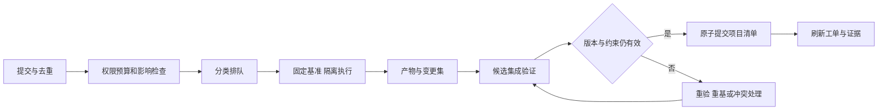

# 共工并发生产与集成规范

版本：0.2。性质：专项规范草案。加载条件：调度或集成并发工程变更时。

按需参考依赖：specs/project-state.md。仅加载与当前职责有关的部分；不要求每个执行任务读取全部依赖。

## 高并发生产与变更集成

系统分别管理请求接入、任务执行和项目合入三种并发。接入量大不代表执行资源充足，执行完成也不代表可以直接写入共享工程。

企业之间实行身份、存储、索引、缓存和计算隔离；企业内按项目设置配额与资源池；项目内按变更影响范围安排协作。调度综合交付期限、优先级、等待时间、资源类型和公平性，避免大批任务饿死小任务。实时交互与离线批量任务使用可区分的队列和容量保障。

分布式队列可重复投递，业务通过幂等键、唯一约束和状态检查保证一次生效。身份、项目、请求内容和版本共同约束去重范围，避免把新需求误作旧任务。对模型外部调用记录请求和产物；调用结果不确定时先核查，不能盲目重试造成重复消费。

宿主在派发前预留预算，执行时记录消费和剩余额度，结束后结算释放；单任务独立检查预算不足以阻止并发超支。任务租约配合单调递增的执行凭证，阻止失联旧实例在恢复后覆盖新结果。不可取消的外部调用需记录潜在尾部成本。

变更集保存基准提交、意图与策略版本、读取依赖及版本、写入对象和属性、资源哈希、测试证据、负责人和恢复点。读写集合由任务申报、工具观测和静态分析共同形成；动态行为未知时扩大验证范围，不能声称依赖已完全识别。

普通任务在独立工作区生产。候选集成器检查目标版本和冲突，组装候选版本并运行适用检查，通过后以版本条件更新项目清单。资源先写入不可变存储，发布以项目清单引用为准；提交失败的孤立资源延后清理。跨代码、资产和外部工单系统不假定存在分布式原子事务，采用可靠事件与补偿同步。

共享工程按冲突域安排集成队列。独立内容可以并行验证与合入；公共接口、共享资源或重叠对象进入相应队列。跨多个冲突域的变更，按固定顺序协调或走共同候选版本，避免死锁与部分合入。

任务状态区分排队、执行、已提交、验证、待合入、已合入、已验收，以及阻塞、失败、取消、失效。产物生成成功不能直接跳到已验收。失败恢复从检查点重启，保留失败证据，限制重试次数并识别需要人工或方法调整的错误。
